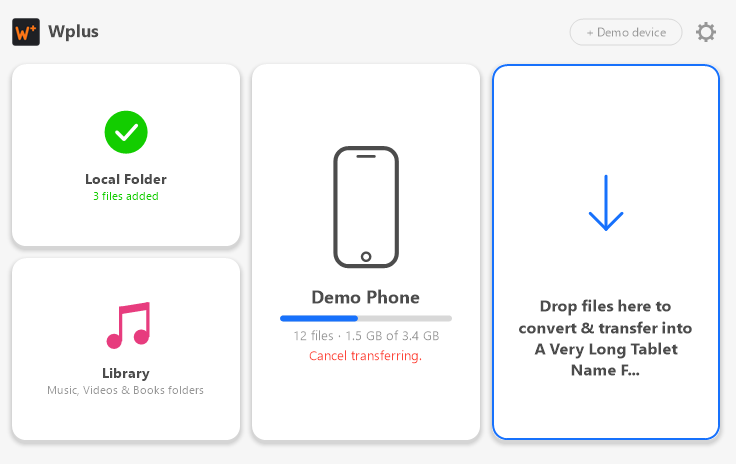
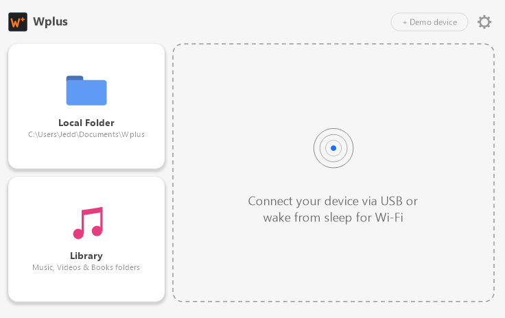
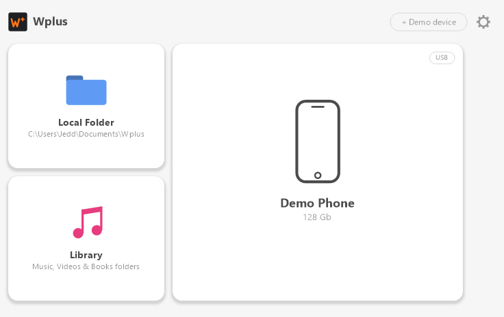

# Wplus

A small Windows app for moving media by drag and drop. Drop music, videos,
audiobooks, ringtones, PDFs or EPUBs onto a tile and Wplus files them where
they belong, with live progress.

No accounts, no trials, no licence keys.



## Download

Get `Wplus.exe` from the [latest release](https://github.com/muleskin/Wplus/releases/latest).
It's one self-contained file for 64-bit Windows, so you don't need to install
.NET. Download it and run it.

## What it does

| Tile | What happens when you drop files on it |
|---|---|
| **Local Folder** | Copies the files into a folder you pick (default `Documents\Wplus`). Existing files are never overwritten; a second copy becomes `name (2).ext`. |
| **Library** | Files media into your Music, Videos and Documents folders by type. |
| **Device** | Shows a phone or tablet with capacity, progress and status. Device transfer is **simulated** for now; use **+ Demo device** to try it. |

You can also click a tile to browse for files. The gear button opens Settings
(theme, Library tile on/off, Local Folder location).

| Waiting for a device | Device connected |
|---|---|
|  |  |

### Supported files

| Group | Extensions |
|---|---|
| Audio | mp3 aac m4a wav flac ape aif aiff wma ogg oga dff tta tak wv dsf cue |
| Video | mp4 m4v mov avi mkv wmv dv m2v webm mpeg mpg flv 3gp m2ts ts mpe mts rm rmvb vob |
| Subtitles | srt ass ssa sub |
| Audiobooks | m4b |
| Ringtones | m4r |
| Books | epub pdf |

## Command line

```
Wplus.exe                         normal start
Wplus.exe --demo                  start with example transfers in progress
Wplus.exe --empty                 start with no device
Wplus.exe --screenshot out.png    draw the window, save it as a PNG, exit
Wplus.exe --selftest              check the size/text/file-type/copy rules, exit 0 or 1
```

## Building

Needs the .NET 10 SDK on Windows.

```powershell
cd app
dotnet run                 # run from source
.\publish.ps1              # single self-contained exe in app\publish\Wplus.exe
```

C# WinForms (`net10.0-windows`), drawn by hand with no extra packages. The
sizes, colours, timings and text rules are in [app/MECHANICS.md](app/MECHANICS.md).
